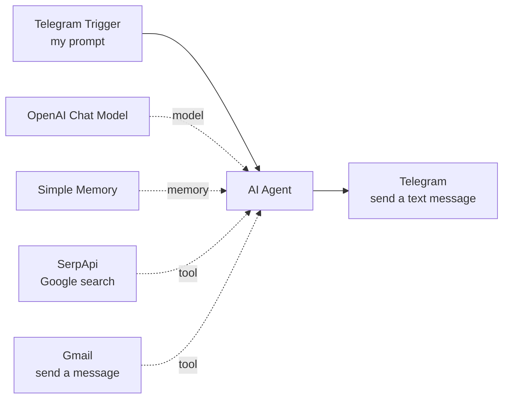

# My First AI Agent (n8n)

One Telegram prompt makes this agent search the web, then message and email me the answer. It was my first step from no-code workflows into agentic automation.

*The n8n canvas. The workflow is published and runs from Telegram.*

## The flow

1. **Telegram Trigger.** I send a prompt from Telegram.
2. **AI Agent.** An OpenAI Chat Model interprets the request, and Simple Memory holds context across the conversation.
3. **SerpApi tool.** Lets the agent search Google in real time.
4. **Gmail tool.** Sends the researched answer to my inbox.
5. **Telegram reply.** The answer also comes straight back to me on Telegram.

## The lesson: an agent will not chain tools on its own

The nodes were the easy part. An AI agent does not decide by itself to use one tool and then another. The system prompt has to say so explicitly, in plain language: "search first, then email the result."

Without that instruction, the agent stops after one tool. It is a small detail that makes a big difference.

## Tools

n8n AI Agent node, OpenAI Chat Model, Simple Memory, SerpApi (Google search tool), Gmail tool, Telegram Bot API.

## More from me

See my other builds at [frankdespi.github.io](https://frankdespi.github.io) and on my [GitHub profile](https://github.com/Frankdespi).
